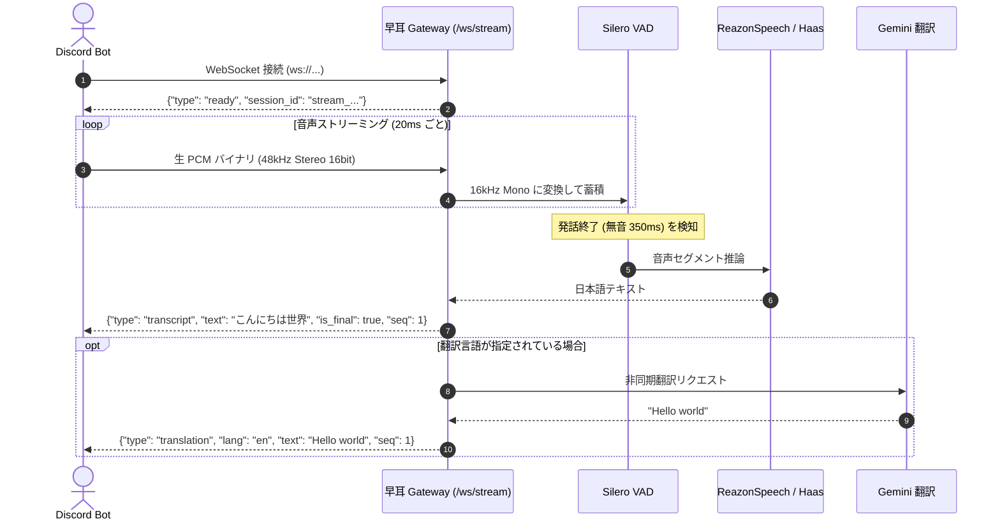

# 早耳 Live (Hayamimi) 音声ストリーミング & リアルタイム翻訳 API 仕様書

外部アプリケーション（Discord Bot、ボイスレコーダー、別サーバー上のオーディオパイプラインなど）から、リアルタイムに音声をストリーミング送信して高精度な文字起こし（ASR）および多言語翻訳テキストを受け取るための WebSocket API 仕様です。

---

## 1. 概要

- **プロトコル**: WebSocket (Binary & JSON)
- **エンドポイント**:
  - ローカル LAN 接続: `ws://192.168.11.244:8833/ws/stream`（ポート 8833）
  - クラウド経由 (FQDN): `wss://hayamimi.kit-a.net/ws/stream`
- **特徴**:
  - **Bot 側ノーリサンプル**: Discord 標準の `48kHz 16-bit PCM Stereo (s16le)` をそのまま送信可能。サーバー側で 16kHz Mono Float32 にリアルタイム自動変換（変換遅延 < 0.1ms）。
  - **自動発話区間検出 (Silero VAD)**: 無音区間を自動検知して発話ごとに自動分割・確定。
  - **多言語リアルタイム翻訳**: 発話が確定した瞬間に、指定した言語（英語、韓国語、中国語など）の翻訳結果を非同期で返却。
  - **非ブロッキング**: 音声取り込みと推論処理が分離されているため、パケット詰まりや遅延が発生しません。

---

## 2. 接続パラメータ (Query Parameters)

WebSocket 接続時の URL クエリパラメータとして以下を指定します。

| パラメータ | 型 | デフォルト値 | 説明 |
| :--- | :--- | :--- | :--- |
| `sample_rate` | int | `48000` | 音声のサンプリングレート（48000, 44100, 16000 など） |
| `channels` | int | `2` | チャンネル数（`1`=モノラル, `2`=ステレオ）。Discord 音声は通常 `2` |
| `format` | string | `s16le` | 音声データフォーマット（`s16le`=16bit 符号付き整数, `f32le`=32bit 浮動小数点） |
| `model` | string | `reazon` | ASR 推論モデル（`reazon`=ReazonSpeech Zipformer, `haas`=Haas ONNX） |
| `trans_langs` | string | `""` | 翻訳先言語コード（カンマ区切り。例: `en`, `en,ko`）。空の場合は翻訳なし |
| `gemini_key` | string | `""` | 翻訳用 Gemini API キー。省略時はユーザーまたはサーバー既定のキーを使用 |
| `draft` | bool | `false` | 発話中のドラフト（中間途中経過）を受信するかどうか |
| `token` | string | `""` | 早耳 Web の OBS 連携トークン（任意）。指定すると登録済みの置換辞書が適用されます |

### 接続 URL 例
```text
ws://192.168.11.244:8833/ws/stream?sample_rate=48000&channels=2&format=s16le&model=reazon&trans_langs=en
```

---

## 3. 通信シーケンス



---

## 4. メッセージフォーマット (JSON)

### 1. サーバー ➔ クライアント: 接続準備完了 (`ready`)
接続が受理されると、最初にサーバーから設定内容が返されます。
```json
{
  "type": "ready",
  "session_id": "stream_a1b2c3d4",
  "sample_rate": 48000,
  "channels": 2,
  "format": "s16le",
  "model": "reazon",
  "trans_langs": ["en"]
}
```

### 2. クライアント ➔ サーバー: 音声送信
WebSocket の **バイナリフレーム (Binary Message)** として生の PCM バイト列をそのまま送信します。
- 送信単位の目安: 20ms 〜 100ms 程度（Discord の場合は 20ms = 3,840 バイト）。

### 3. サーバー ➔ クライアント: 文字起こし結果 (`transcript`)
発話が検出・終了した際に送信されます。
```json
{
  "type": "transcript",
  "text": "本日はよろしくお願いします。",
  "is_final": true,
  "seq": 1,
  "latency_ms": 142.5,
  "asr_ms": 138.2
}
```
- `text`: 句読点（、。）や単語置換が適用された認識テキスト
- `is_final`: `true`（発話終了による確定テキスト）
- `seq`: 発話シーケンス番号（1 から順にインクリメント）
- `latency_ms`: サーバー側の総処理時間（ミリ秒）

### 4. サーバー ➔ クライアント: 翻訳結果 (`translation`)
`trans_langs` を指定している場合、確定テキストに対応する翻訳結果が届きます。
```json
{
  "type": "translation",
  "lang": "en",
  "text": "Thank you for having me today.",
  "seq": 1,
  "original": "本日はよろしくお願いします。"
}
```
- `seq`: どの確定テキスト（`transcript` の `seq`）に対する翻訳かが紐付けられます。

### 5. Keepalive (`ping` / `pong`)
長時間の無音時など、接続維持のために JSON テキストで ping を送信できます。
- クライアント送信: `{"type": "ping", "ts": 1710000000.0}`
- サーバー応答: `{"type": "pong", "ts": 1710000000.0}`

---

## 5. 実装サンプルコード (Python)

外部スクリプトや Discord Bot から本 API を利用する最小限の Python サンプルです。

```python
import asyncio
import json
import websockets

GATEWAY_URL = "ws://192.168.11.244:8833/ws/stream?sample_rate=48000&channels=2&format=s16le&model=reazon&trans_langs=en"

async def receive_handler(ws):
    """サーバーからの字幕・翻訳イベントを受信する"""
    async for message in ws:
        data = json.loads(message)
        msg_type = data.get("type")
        
        if msg_type == "ready":
            print(f"[*] 接続完了: Session ID = {data.get('session_id')}")
        elif msg_type == "transcript":
            print(f"[文字起こし #{data.get('seq')}] {data.get('text')} ({data.get('latency_ms')}ms)")
        elif msg_type == "translation":
            print(f"[翻訳 ({data.get('lang')}) #{data.get('seq')}] {data.get('text')}")

async def send_audio_handler(ws, pcm_stream_generator):
    """
    Discord Bot から受け取った 48kHz Stereo 16bit PCM チャンクを連続送信する。
    pcm_stream_generator は bytes (例: 20ms = 3840 bytes) を yield するジェネレータ。
    """
    async for chunk in pcm_stream_generator:
        await ws.send(chunk)

async def main():
    async with websockets.connect(GATEWAY_URL) as ws:
        # 受信タスクを開始
        recv_task = asyncio.create_task(receive_handler(ws))
        
        # 音声送信タスク（例としてダミー送信または Bot 音声ハンドラ）
        # await send_audio_handler(ws, my_discord_voice_generator())
        
        await recv_task

if __name__ == "__main__":
    asyncio.run(main())
```

---

## 6. Discord Bot (discord.py / py-cord) での利用ヒント

Discord Bot でボイスチャンネル内の特定ユーザーの音声のみを受信するには、`discord.ext.voice_recv` などのライブラリを使用します。

```python
from discord.ext import voice_recv

class HayamimiSink(voice_recv.AudioSink):
    def __init__(self, target_user_id: int, ws_queue: asyncio.Queue):
        self.target_user_id = target_user_id
        self.ws_queue = ws_queue

    def wants_opus(self) -> bool:
        return False  # PCM (48kHz Stereo 16-bit) を受信

    def write(self, user, data: voice_recv.VoiceData):
        if user and user.id == self.target_user_id:
            # 20ms ごとの raw PCM (3840 bytes) を WebSocket 送信キューに投入
            self.ws_queue.put_nowait(data.pcm)
```
このように、`data.pcm` をそのまま `/ws/stream` の WebSocket に流し込むだけで、Bot 側の CPU 負荷をほとんどかけずに文字起こしと翻訳テキストを取得できます。


---

## 7. テキスト双方向翻訳 API (`POST /api/translate`)

音声認識を介さず、テキスト（チャットメッセージ等）だけを直接送信して翻訳結果を取得できる REST API です。
サーバー内蔵の完全ローカル翻訳モデル（英語: FuguMT / 多言語: M2M-100）のみを使用し、外部 API や API キーは一切不要です。

### 基本情報
- **エンドポイント**:
  - ローカル LAN 接続: `http://192.168.11.244:8833/api/translate`
  - クラウド経由 (FQDN): `https://hayamimi.kit-a.net/api/translate`
- **メソッド**: `POST`
- **Content-Type**: `application/json`

### 自動ルーティング仕様
- **日本語のテキスト**が送信された場合 ➔ `target_langs` で指定された言語（複数可、未指定時は `["en"]`）へ翻訳して返却します。
- **他言語のテキスト**（英語・韓国語・中国語・スペイン語・フランス語など）が送信された場合 ➔ 自動で言語判定し、**日本語 (`ja`)** へ翻訳して返却します。

### リクエストパラメータ (JSON Body)

| フィールド | 型 | 必須 | デフォルト | 説明 |
| :--- | :--- | :---: | :--- | :--- |
| `text` | string | **必須** | - | 翻訳したい元のテキスト |
| `target_langs` | array \| string | 任意 | `["en"]` | 入力が日本語の場合の翻訳先言語リスト（例: `["en", "ko"]` または `"en,ko"`） |
| `source_lang` | string | 任意 | 自動判定 | 入力言語を明示指定したい場合のみ指定（例: `"en"`, `"ko"`, `"ja"`） |

#### 対応主要言語コード (`target_langs`)
- `en`: 英語
- `ko`: 韓国語
- `zh`: 中国語（簡体字）
- `zh-tw`: 中国語（繁体字）
- `es`: スペイン語
- `fr`: フランス語
- `de`: ドイツ語
- `pt`: ポルトガル語
- `vi`: ベトナム語
- `id`: インドネシア語

### リクエスト & レスポンス例

#### パターン A: 日本語 ➔ 複数言語（英語・韓国語）
```json
POST /api/translate
{
  "text": "本日はよろしくお願いします。",
  "target_langs": ["en", "ko"]
}
```
**レスポンス:**
```json
{
  "ok": true,
  "source_lang": "ja",
  "original": "本日はよろしくお願いします。",
  "translations": {
    "en": "Thank you for having me today.",
    "ko": "오늘도 잘 부탁드립니다."
  },
  "latency_ms": 145.2
}
```

#### パターン B: 他言語（英語・韓国語など） ➔ 自動で日本語へ
```json
POST /api/translate
{
  "text": "Hello everyone, nice to meet you today!"
}
```
**レスポンス:**
```json
{
  "ok": true,
  "source_lang": "en",
  "original": "Hello everyone, nice to meet you today!",
  "translations": {
    "ja": "こんにちはみなさん、今日はお会いできてよかったです!"
  },
  "latency_ms": 182.5
}
```

### Python (`aiohttp`) 実装サンプル

```python
import aiohttp

TRANSLATE_URL = "http://192.168.11.244:8833/api/translate"

async def translate_message(text: str, target_langs: list[str] | None = None) -> dict:
    payload = {"text": text}
    if target_langs:
        payload["target_langs"] = target_langs

    async with aiohttp.ClientSession() as session:
        async with session.post(TRANSLATE_URL, json=payload, timeout=10.0) as resp:
            resp.raise_for_status()
            return await resp.json()

# 使用例 1 (日本語 -> 英語・韓国語)
# res = await translate_message("お疲れ様です！", ["en", "ko"])
# print(res["translations"])  # {'en': '...', 'ko': '...'}

# 使用例 2 (他言語 -> 自動で日本語)
# res = await translate_message("Good morning everyone!")
# print(res["translations"]["ja"])
```
