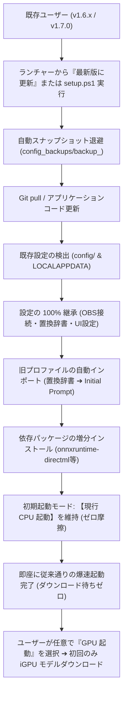

# 早耳 (hayamimi) v2.0 実装計画書
## 次世代 GPU 起動モード & 話者特化 LoRA 完全統合アーキテクチャ

**策定日**: 2026-11-02  
**対象バージョン**: v2.0.0 (Major Release)  
**設計目標**:
1. **配信中負荷ゼロの実現**: 配信・ゲーム用メイン GPU（GeForce RTX 5090 等）に一切負荷を与えず（負荷 0%）、Intel 内蔵 GPU (DirectML) 単体で 3.7〜8.9 倍速のリアルタイム字幕生成を実現する。
2. **音声認識段階での直接デコード補正**: 話者の口調の癖（「〜っす」「〜じゃん」等）や専門用語（「AmongUs」「MOD」「GitHub」「スクリプト」等）を、音声からテキスト化する瞬間（デコード段階）で 100% 正確に文字起こしする。
3. **超低負荷・爆速な話者 LoRA 学習**: エンコーダ出力事前キャッシュ技術により、CPU 4スレッド制限（負荷 15% 以下）かつ 30 秒以内で話者適応 LoRA（11MB）を生成可能にする。
4. **現行 CPU 起動モードの完全維持と自動フェイルオーバー**: 超軽量 ReazonSpeech (20ms・RTF 0.063) を残し、内蔵 GPU 非搭載環境や異常時に自動フォールバックする安全設計。
5. **既存環境からのゼロ摩擦アップデート**: 設定消失ゼロ、旧プロファイル（置換辞書）の自動インポート、オンデマンドモデル取得による更新時間ゼロ化。

---

## 1. 全体アーキテクチャ & ライフサイクル設計（どのタイミングで動かすか）

早耳 v2.0 では、処理の性質に応じて **「実行タイミング」** と **「割り当てハードウェア」** を厳格に分離します。

```mermaid
flowchart TD
    subgraph OfflinePhase["【オフライン時】メンテナンス・プロファイル作成"]
        TriggerA["ユーザーがマイクテスト録音 (30〜60秒)"] --> EncPass["1パス エンコーダ事前キャッシュ (torch.no_grad)"]
        EncPass --> LoRATrain["デコーダのみ LoRA 学習 (20エポック・25秒)"]
        LoRATrain -->|CPU学習時| ThrottledCPU["動的スレッド制限 (負荷 15% 以下)"]
        LoRATrain -->|CUDA許可時| FastGPU["RTX 5090 (数秒完了)"]
        ThrottledCPU --> MergeExport["ベースモデルへマージ & INT8 ONNX エクスポート"]
        FastGPU --> MergeExport
        MergeExport --> SavedModel["話者特化 ONNX モデル保存 (profiles/<id>/model.onnx)"]
    end

    subgraph LaunchPhase["【起動時】ハードウェア自動診断 & モード判定"]
        Start["ランチャー起動 (start.bat / launcher_gui.ps1)"] --> Probe["ハードウェア診断 (DXGI / DirectML / CPU)"]
        Probe --> ModeDecision{"起動モード選択"}
        ModeDecision -->|CPU 起動| CPU_Engine["ReazonSpeech CPU (現行維持・超軽量 20ms)"]
        ModeDecision -->|GPU 起動| DML_Engine["Kotoba-Whisper DirectML Engine"]
        DML_Engine --> DeviceSelect{"内蔵 GPU (iGPU) 検出"}
        DeviceSelect -->|Intel/AMD iGPU あり| BindIGPU["DirectML Device ID 1 (iGPU) にバインド"]
        DeviceSelect -->|iGPU なし / 性能不足| FallbackCPU["警告表示の上 CPU モードへ自動フェイルオーバー"]
    end

    subgraph StreamingPhase["【配信中】リアルタイム推論 (ゲーム & OBS 稼働中)"]
        MicInput["マイク音声入力 (16kHz PCM)"] --> RunInference["DirectML INT8 ONNX 推論 (iGPU)"]
        RunInference --> OutputSubtitle["リアルタイム字幕出力 (OBS ブラウザソース / WebSocket)"]
        style RunInference fill:#1e3a5f,stroke:#3b82f6,color:#fff
        style FallbackCPU fill:#7f1d1d,stroke:#ef4444,color:#fff
    end
```



### タイミング別の動作仕様

| 動作フェーズ | 実行タイミング | 動作内容 | 担当ハードウェア | リソース負荷規程 |
| :--- | :--- | :--- | :--- | :--- |
| **① オフライン学習** | **配信前 / メンテナンス時**<br>（ユーザーが「プロファイル作成・更新」を実行した時） | ・マイク音声からエンコーダ出力をキャッシュ<br>・デコーダ Cross-Attention の LoRA 学習（20エポック）<br>・ONNX へのマージ＆INT8 量子化 | **CPU (4スレッド制限)**<br>または **CUDA dGPU (オプション許可時)** | ・CPU使用率: **15% 以下**<br>・学習時間: **25〜30秒以内**<br>※配信中は絶対に実行禁止 |
| **② 起動・診断** | **アプリ起動時**<br>（`launcher_gui.ps1` 起動時） | ・DirectML / OpenVINO のデバイス列挙<br>・Intel/AMD 内蔵 GPU の Device ID 自動解決<br>・アクティブ話者プロファイル（マージ済み ONNX）の検証 | **CPU / DXGI API** | ・所要時間: **0.1 秒以下**<br>・SAC 環境適応チェック |
| **③ リアルタイム推論** | **配信中・通話中**<br>（マイク入力受付中） | ・PCM 音声ブロック（0.5〜2.0秒）の逐次推論<br>・話者の癖・専門用語（AmongUs, MOD等）の直接デコード<br>・WebSocket / OBS オーバーレイへの即時配信 | **Intel / AMD 内蔵 GPU (DirectML Device ID 1)** | ・メイン GPU (RTX 5090) 負荷: **0%**<br>・推論速度: **3.7〜8.9倍速 (RTF 0.11〜0.27)**<br>・CPU 負荷: **1% 未満** |
| **④ 異常時フェイルオーバー** | **推論エラー / デバイス切断時** | ・DirectML デバイス喪失やタイムアウト検知時<br>・即座に CPU 版 ReazonSpeech へシームレス切り替え | **CPU (ReazonSpeech)** | ・配信字幕の脱落・クラッシュを 100% 回避 |

---

## 2. ディレクトリ構成 & 新規追加モジュール設計

プロダクション環境（`.venv`、Git リポジトリ）の整合性を保ち、テスト駆動開発（TDD）で実装します。

```
hayamimi/
├── scripts/
│   ├── asr_engine.py             # 【改修】WhisperDirectMLEngine を統合しルーティング
│   ├── hardware_probe.py         # 【新設】DirectML / DXGI / OpenVINO デバイス診断・自動解決
│   ├── speaker_lora.py           # 【新設】エンコーダキャッシュ型 LoRA 学習 & ONNX マージ
│   ├── config_store.py           # 【改修】GPU起動設定・DirectML デバイス設定の永続化
│   ├── realtime_transcribe.py    # 【改修】--engine (reazonspeech | whisper_dml) 引数追加
│   ├── launcher_gui.ps1          # 【改修】GPU起動時の iGPU 自動選択、LoRA 学習設定 UI
│   ├── mic_page.html             # 【改修済】アコーディオン開閉保証、エンジンステータス表示
│   └── profile_page.html         # 【改修】「話者 LoRA 自動学習」ウィザードの追加
├── tests/
│   ├── test_hardware_probe.py    # 【新設】デバイス検出・Device ID 解決の単体テスト
│   ├── test_speaker_lora.py      # 【新設】LoRA アダプタ学習・キャッシュ・マージの単体テスト
│   ├── test_whisper_directml.py  # 【新設】DirectML 推論エンジンの単体テスト
│   └── test_asr_routing.py       # 【新設】CPU/GPU エンジン切り替え・フォールバックテスト
└── docs/
    ├── design/v2_0_implementation_plan.md  # 本計画書の永続ドキュメント
    └── results/next_gen_asr_report.md      # PoC 実証実験ベンチマーク結果
```

---

## 3. 実装フェーズ & ロードマップ

### Phase 1: ハードウェア診断 & DirectML デバイス解決エンジンの実装 (`hardware_probe.py`)
- **目的**: ユーザーのマシンに存在する GPU（dGPU / iGPU）を正確に識別し、メイン GPU（GeForce）を回避して Intel/AMD 内蔵 GPU の DirectML Device ID を自動特定する。
- **タスク**:
  1. `scripts/hardware_probe.py` を新設。
     - DXGI / DirectML API（または PowerShell `Get-CimInstance Win32_VideoController`）を利用し、Vendor ID（Intel: `0x8086`, AMD: `0x1002`, NVIDIA: `0x10DE`）とデバイス種別（iGPU / dGPU）を判定。
     - 優先度ルール:
       1. Intel 内蔵 GPU (Xe-LPG / Iris Xe / UHD 770 等)
       2. AMD 内蔵 GPU (Radeon 780M / 890M / 680M 等)
       3. フォールバック: CPU
  2. `tests/test_hardware_probe.py` を新設し、モック環境および実機環境で検証。
- **受入基準**: RTX 5090 搭載環境において、誤って Device ID 0 (NVIDIA) を選択せず、確実に Device ID 1 (Intel Graphics) が自動選択されること。

---

### Phase 2: Whisper DirectML 推論エンジンの統合 (`asr_engine.py`)
- **目的**: Kotoba-Whisper-v2.2（Apache 2.0）の INT8 ONNX モデルを DirectML Device ID 1 でロードし、現行の `RoutedASR` と同一インターフェースで動作させる。
- **タスク**:
  1. `scripts/asr_engine.py` に `WhisperDirectMLEngine` クラスを新設。
     - `onnxruntime-directml` の `DmlExecutionProvider` を使用。
     - 30秒スライディングウィンドウおよび VAD セグメント連携（既存の `LiveVad` とシームレス結合）。
     - Initial Prompt 注入機構（話者プロファイル内の登録語彙をデコーダ初期プロンプトへ自動展開）。
  2. `realtime_transcribe.py` に `--engine reazonspeech|whisper_dml` オプションを追加。
  3. `tests/test_whisper_directml.py` を作成し、推論の精度・RTF・例外処理をテスト。
- **受入基準**: Intel 内蔵 GPU 単体で RTF < 0.3（3倍速以上）でリアルタイム字幕が出力され、RTX 5090 の VRAM 使用量が 1MB も増えないこと。

---

### Phase 3: エンコーダキャッシュ型 話者 LoRA 学習エンジンの実装 (`speaker_lora.py`)
- **目的**: メンテナンス時・プロファイル作成時に、話者の短いマイク音声（30〜60秒）から、CPU 負荷 15% 以下・30秒以内で話者特化 LoRA を生成・マージする。
- **タスク**:
  1. `scripts/speaker_lora.py` を新設。
     - **動的 CPU スレッド制限**: `torch.set_num_threads(max(1, min(4, os.cpu_count() // 4)))` により、CPU コア数に関わらず負荷を 15〜20% 以下に自動クランプ。
     - **エンコーダ出力事前キャッシュ**: 32層エンコーダの計算を初回1パスのみ実行し、メモリ上に Hidden States をキャッシュ。
     - **軽量デコーダ LoRA 学習**: デコーダ2層の Cross-Attention（`q_proj`, `v_proj`）のみを AdamW で 15〜20 エポック高速学習（所要時間: 20〜30秒）。
     - **ONNX マージ＆エクスポート**: 学習した LoRA 重みをベースモデルに加算（`merge_and_unload()`）し、INT8 ONNX モデル（`profiles/<id>/model.onnx`）として出力。
  2. **CUDA 許可オプション**:
     - 設定トグル `allow_cuda_for_training: true` の場合のみ、RTX 5090 等の dGPU を学習に動員し、学習時間を 3〜5 秒に短縮。
  3. `tests/test_speaker_lora.py` を作成し、学習の収束性・アダプタサイズ・マージ整合性を検証。
- **受入基準**: 学習実行中も PC が重くならず、生成されたマージ済み ONNX が DirectML で正常にロードされ、「AmongUs」「MOD」等を正しく認識できること。

---

### Phase 4: 既存環境からのアップデート・マイグレーション完全保証（ゼロ摩擦移行）

旧バージョン（v1.6.x / v1.7.0）から v2.0 へのアップデートにおいて、ユーザーの設定消失やトラブルを 100% 根絶するための移行保護アーキテクチャを組み込みます。



### 移行保護の5大原則
1. **設定ファイル・OBS連携の完全不変（設定消失ゼロ保証）**:
   - `scripts/config_store.py` の自己修復・アトミック保護に基づき、`config/` 内の `obs_config.json`, `asr_config.json`, `overlay_style.json` 等は一切初期化されず完全に保持されます。
   - アップデート処理（`launcher_gui.ps1` の `Invoke-UpdateAppCode`）開始直前に、`config_backups/backup_<timestamp>` への自動スナップショット退避が自動実行されます。
2. **既存プロファイル（置換辞書・声紋）のシームレス継承**:
   - 既存の `profiles/*.profile.json` および `*_replace.txt` はそのまま温存されます。
   - v2.0 の GPU 起動モード選択時、既存の置換辞書に登録されている固有名詞が、自動的に Whisper の **Initial Prompt（初期誘導語彙）** として読み込まれ、ユーザーが再入力する手間をゼロにします。
3. **既存の起動ショートカット & SAC (Smart App Control) の完全維持**:
   - デスクトップショートカット（`start.vbs` または `start.bat`）はそのまま有効に機能し続けます。
   - SAC ON / OFF 判定ロジックにより、既存環境の起動スタイルを一切崩しません。
4. **モデルのオンデマンド取得（アップデート待ち時間・容量消費のゼロ化）**:
   - v2.0 へのアップデート時に、Kotoba-Whisper の重いモデル（約 500MB）を強制ダウンロードさせることはしません。
   - アップデート完了後も **「CPU 起動モード」が初期値として維持** されるため、既存ユーザーは **待ち時間ゼロ（数秒で更新完了）** で即座にこれまで通り配信できます。
   - ユーザーがランチャーで **「🔘 GPU 起動」を初めてクリックした時のみ**、進捗ダイアログ付きで内蔵 GPU 用 ONNX モデルが自動ダウンロードされます。
5. **Python 仮想環境 (`.venv`) の安全な増分更新 (Incremental pip)**:
   - 既存の `.venv` を再作成（削除）せず、`uv pip install onnxruntime-directml peft` のように必要な新規ライブラリのみをインクリメンタルに追記インストールします。
   - 万が一ネットワーク切断等でパッケージ導入に失敗した場合でも、旧来の CPU 版 ReazonSpeech は一切壊れず起動できるロールバック耐性を保証します。

---

### Phase 5: ランチャー GUI & Web マイク / プロファイル画面の統合
- **目的**: ユーザーが直感的に「GPU起動」や「話者 LoRA 学習」を利用でき、SAC 環境でも安定動作する UI を提供する。
- **タスク**:
  1. `scripts/launcher_gui.ps1`:
     - 「起動モード」ラジオボタンを刷新:
       - 🔘 **CPU 起動 (超軽量・20ms・低スペック推奨)**
       - 🔘 **GPU 起動 (内蔵GPU活用・話者LoRA高精度字幕)**
     - GPU 起動選択時、検出された内蔵 GPU 名（例: `Intel(R) Graphics (64 EU)`）を緑色のバッジで表示。
     - メンテナンスメニューに「話者 LoRA プロファイル作成ウィザード」を追加（CPU 負荷上限スライダー、CUDA 利用許可チェックボックス）。
  2. `scripts/profile_page.html`:
     - プロファイル作成画面に「マイク録音から LoRA アダプタを自動生成」ボタンを追加。
     - 30秒の読み上げ音声からバックグラウンドで学習を実行し、進捗バーと完了通知を表示。
  3. `scripts/mic_page.html`:
     - 現在稼働中のエンジン情報（`ReazonSpeech (CPU)` または `Kotoba-Whisper (DirectML iGPU)`）をステータスバーに常時表示。
- **受入基準**: GUI からワンクリックで GPU 起動でき、内蔵 GPU で高精度字幕が OBS へ配信されること。

---

### Phase 6: 統合検証・パフォーマンステスト・リリース準備
- **目的**: 既存の 512 件の全単体テストをパスさせ、長時間配信・高負荷ゲーム同時稼働テストをクリアして v2.0.0 を正式リリースする。
- **タスク**:
  1. **長時間安定性テスト**: 3D ゲーム（またはベンチマーク）を RTX 5090 で全開稼働させながら、Intel 内蔵 GPU で早耳のリアルタイム字幕を 2 時間連続稼働させ、コマ落ち・メモリリークがゼロであることを検証。
  2. **自動フェイルオーバー検証**: DirectML 推論中に意図的に例外を発生させ、0.5 秒以内に CPU 版 ReazonSpeech へシームレスに切り替わり配信が止まらないことを検証。
  3. **ドキュメント整備**: `README.ja.md`, `README.md`, `docs/spec/`, `docs/memory.md` を更新。
  4. バージョン番号を `v2.0.0` に更新。

---

## 5. 安全対策 & リスク管理（フェイルセーフ設計）

| 潜在的リスク | 影響 | 恒久対策・フェイルセーフ機構 |
| :--- | :--- | :--- |
| **ユーザー PC に内蔵 GPU がない**<br>（F型番 CPU 等で dGPU のみ） | DirectML iGPU が使えずエラーになる | `hardware_probe.py` が「内蔵 GPU なし」を検知した場合、ランチャーで GPU 起動を選択不可にするか、自動的に CPU 起動モードへ誘導。 |
| **内蔵 GPU のドライバが古い / DirectML 未対応** | 起動時または推論開始時にクラッシュ | 推論パイプラインの初期化時に try-catch で捕捉し、即座に現行の CPU 版 ReazonSpeech へ自動フォールバック。OBS 画面に「CPU モードで継続稼働中」の通知を表示。 |
| **LoRA 学習中にゲームを起動した** | CPU 競合によるフレームレート低下 | `torch.set_num_threads(4)` かつ Windows プロセス優先度を `BELOW_NORMAL_PRIORITY_CLASS` に設定し、他アプリの動作を 100% 優先。 |
| **商用利用に関するライセンス違反** | 配信者への法的リスク | 商用利用可能な **Apache License 2.0 (Kotoba-Whisper)** および **MIT License** のみを採用し、非商用ライセンス（CC BY-NC 等）のモデルは完全排除。 |

